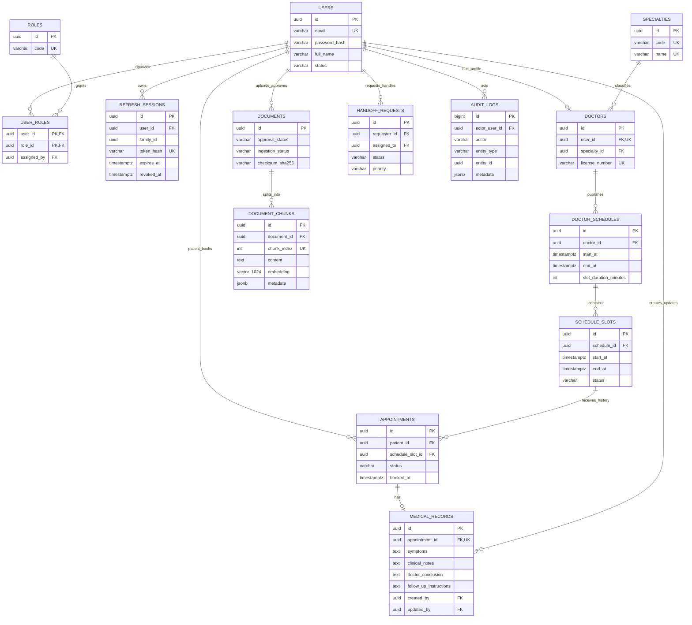

# Thiết kế cơ sở dữ liệu Phase 2

Baseline: **SRS v1.1 Final** của đề tài **Xây dựng hệ thống y tế tích hợp chatbot hỗ trợ tư vấn, tra cứu và đặt lịch hẹn**.

## Quyết định thiết kế

- PostgreSQL là nguồn dữ liệu duy nhất; pgvector lưu dense embedding ngay trong `document_chunks`, không có ChromaDB.
- Khóa chính nghiệp vụ dùng UUID; thời gian dùng `TIMESTAMPTZ`; trạng thái dùng `VARCHAR` kèm `CHECK` do SQLAlchemy enum sinh ra.
- Email có unique index trên `lower(email)` để chống trùng khác hoa/thường.
- `users.phone` nullable vì bảng User dùng chung cho Patient/Doctor/Staff/Admin. FR-AUTH-01 vẫn được bảo đảm ở Phase 5: request schema và registration service của Patient phải bắt buộc, chuẩn hóa và validate phone trước khi tạo User.
- Appointment chỉ tham chiếu `schedule_slot_id`; Doctor và Specialty được truy ngược qua Slot → Schedule → Doctor để tránh dữ liệu lặp.
- `medical_records.appointment_id` vừa là FK vừa UNIQUE, biểu diễn đúng Appointment `1:0..1` MedicalRecord. Không có `doctor_id`, `patient_id` hay `specialty_id` lặp lại.
- Điều kiện “Appointment phải COMPLETED” và “Doctor hiện tại phụ trách lịch đó” là luật liên bảng, phải được khóa/kiểm tra trong cùng transaction ở service Phase 3/6. CHECK của một hàng không thể kiểm tra an toàn trạng thái ở bảng khác.
- Không có cột xóa mềm hoặc API xóa cho MedicalRecord: nghiệp vụ không cho hard-delete. Thay đổi phải cập nhật `updated_at`, `updated_by` và ghi audit metadata, không ghi nội dung lâm sàng.
- Lịch/slot kiểm tra `end_at > start_at`, thời lượng slot từ 5 đến 480 phút, và unique theo doctor/time range hoặc schedule/start. Exact-range unique không chặn hai khoảng giao nhau. Phase 3/6 phải serialize thao tác theo `doctor_id` (PostgreSQL transaction advisory lock hoặc khóa hàng ổn định), rồi kiểm tra `new_start < existing_end AND new_end > existing_start` trong cùng transaction. Test bắt buộc gồm overlap, hai request đồng thời và hai khoảng tiếp giáp không overlap. Phase 2 không thêm `btree_gist` ngoài stack đã chốt.
- Partial unique index `uq_appointments_occupied_slot` cho tối đa một Appointment ở một trong các trạng thái `CONFIRMED`, `COMPLETED`, `NO_SHOW` trên một slot. `COMPLETED/NO_SHOW` tiếp tục chiếm slot vĩnh viễn; `CANCELLED` không tham gia index để BR-04 có thể mở lại slot. Phase 6 vẫn phải cập nhật Appointment và ScheduleSlot trong cùng transaction.
- Refresh token chỉ lưu `token_hash`; `family_id`, `replaced_by_session_id`, `revoked_at` hỗ trợ rotation, phát hiện reuse và thu hồi chuỗi token ở Phase 5.
- `documents` tách trạng thái duyệt và trạng thái ingest. RAG service chỉ được ingest khi `approval_status=APPROVED`.
- Handoff chỉ có `PENDING`, `IN_PROGRESS`, `RESOLVED`; chỉ Staff/Admin được xử lý theo SRS. FK `assigned_to → users.id` bảo đảm tham chiếu, còn RBAC service Phase 5/9 là nơi kiểm tra role vì role là quan hệ N:N động.
- MedicalRecord không có bất kỳ FK hay pipeline nào tới Document/DocumentChunk; dữ liệu khám không được đưa vào RAG/Gemini dùng chung.
- ChatSession chưa tạo: FR-CHAT-05 là Should và không cần để đáp ứng phạm vi schema bắt buộc Phase 2.

## ERD toàn hệ thống

Lưu ý: quan hệ `ScheduleSlot → Appointment` là `1:N` để giữ lịch sử các lần hủy, nhưng partial unique index bảo đảm tại một thời điểm chỉ có tối đa một Appointment `CONFIRMED` trên slot.

## pgvector và BGE-M3

`document_chunks.embedding` dùng `VECTOR(1024)`. Dimension 1024 được chốt từ model card/repository chính thức của BAAI/FlagEmbedding, không suy đoán. HNSW index dùng `vector_cosine_ops`; PostgreSQL planner có thể chọn index này cho `ORDER BY embedding <=> query LIMIT K`, khi đó retrieval là approximate.

RAG V1 dùng exact dense retrieval làm baseline. Phase 8 đã chạy query trong transaction với `SET LOCAL enable_indexscan = off` và kiểm tra `EXPLAIN (FORMAT JSON)` không chọn `ix_document_chunks_embedding_hnsw`. HNSW vẫn được giữ nhưng không dùng cho số liệu exact baseline. Phase 12 mới benchmark HNSW, BM25/RRF và reranker trên cùng query set.

## Chính sách xóa và lịch sử

| FK | ON DELETE | Lý do |
| --- | --- | --- |
| DoctorSchedule → Doctor | RESTRICT | Không xóa Doctor khi còn lịch. |
| ScheduleSlot → DoctorSchedule | CASCADE | Chỉ dọn slot kỹ thuật chưa phát sinh; nếu slot có Appointment, FK RESTRICT kế tiếp chặn toàn bộ lệnh xóa schedule. Nghiệp vụ dùng CANCELLED/BLOCKED. |
| Appointment → ScheduleSlot | RESTRICT | Slot đã phát sinh lịch hẹn không thể bị xóa. |
| MedicalRecord → Appointment | RESTRICT | Appointment có hồ sơ không thể bị xóa; MedicalRecord không cascade. |
| MedicalRecord created_by/updated_by → User | RESTRICT | Giữ tác giả và dấu vết hồ sơ. |

Vì PostgreSQL kiểm tra toàn bộ chuỗi FK trong cùng statement, cascade từ DoctorSchedule không thể vượt qua Appointment `RESTRICT`; do đó Appointment/MedicalRecord lịch sử không bị mất. API nghiệp vụ không hard-delete schedule/slot/appointment/medical record mà đổi trạng thái.

## Vòng đời dữ liệu chính

- Hủy lịch: đổi Appointment sang `CANCELLED`, ghi thời điểm/người/lý do; không xóa hàng.
- Hoàn tất khám: đổi Appointment sang `COMPLETED` và ghi `completed_at`; sau đó Doctor phụ trách mới được tạo một MedicalRecord.
- Cập nhật MedicalRecord: không thay quan hệ Appointment; cập nhật nội dung, `updated_at`, `updated_by` và audit metadata.
- Re-ingest tài liệu: xóa/thay các chunk thuộc đúng Document trong transaction hoặc tạo version Document mới; FK `ON DELETE CASCADE` chỉ áp dụng cho chunk kỹ thuật, không áp dụng MedicalRecord.
- Refresh rotation: session cũ có `revoked_at`, trỏ `replaced_by_session_id`; token mới cùng `family_id`.

Chi tiết từng cột nằm trong [data-dictionary.md](./data-dictionary.md).
