# Sơ đồ kiến trúc cuối

Đề tài: **Xây dựng hệ thống y tế tích hợp chatbot hỗ trợ tư vấn, tra cứu và đặt lịch hẹn.**

Baseline: SRS v1.1. Các sơ đồ dưới đây phản ánh implementation cuối Phase 13/14; không có ChromaDB, Redis, Celery, Docker, microservices hoặc LangChain/LangGraph trong core.

## 1. System Architecture

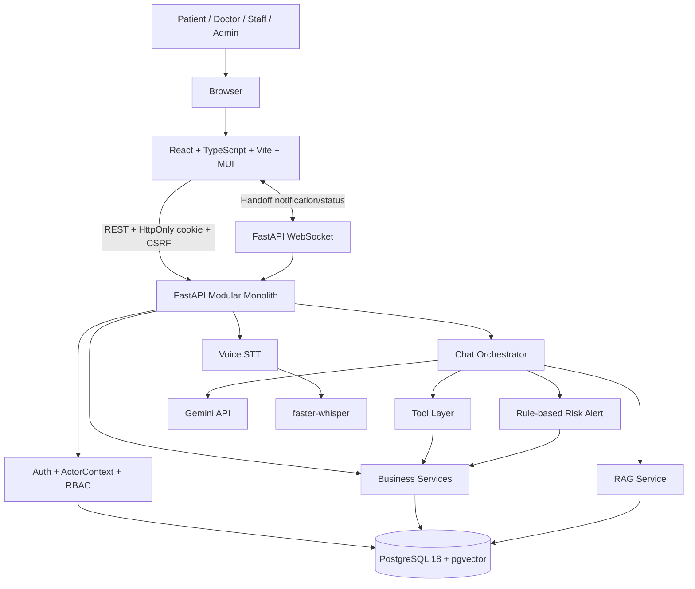

## 2. Frontend / Backend Architecture

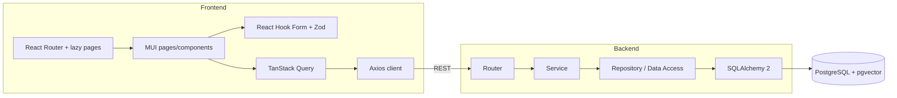

## 3. ERD cuối

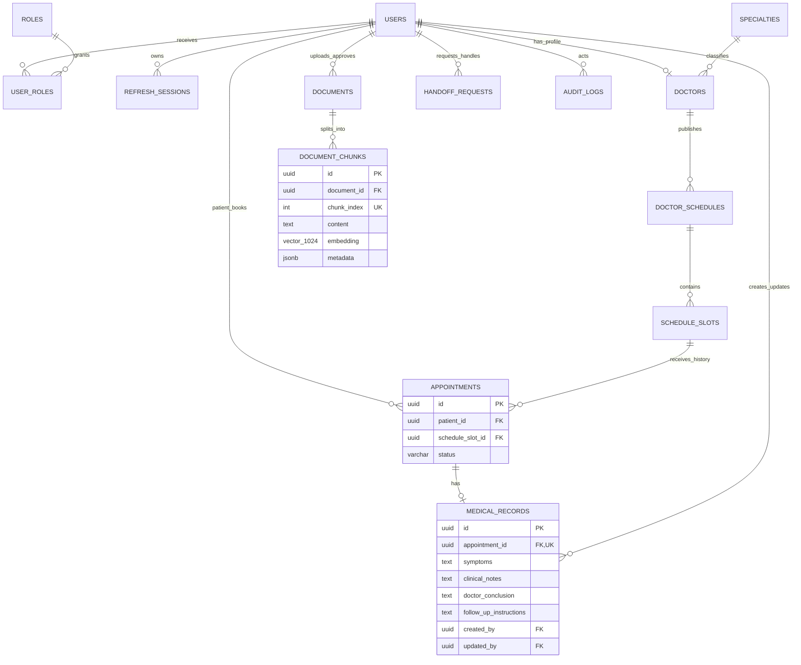

ERD chi tiết và chính sách FK/xóa nằm trong `database-design.md`; Data Dictionary nằm trong `data-dictionary.md`. Patient không có bảng riêng: Patient là `User + PATIENT role`. Doctor có bảng riêng vì cần specialty, license và professional profile. MedicalRecord liên hệ Patient qua Appointment.

## 4. Use Case Diagram

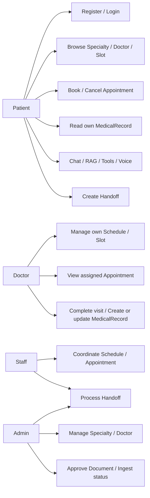

## 5. Authentication Flow

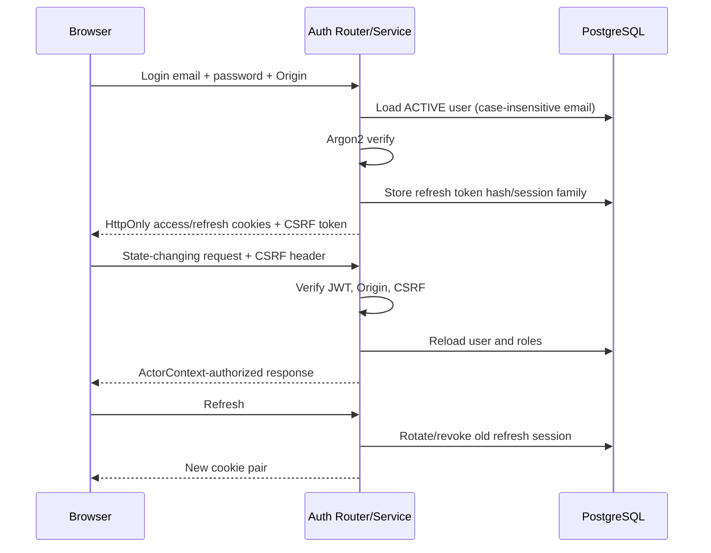

## 6. Booking Sequence

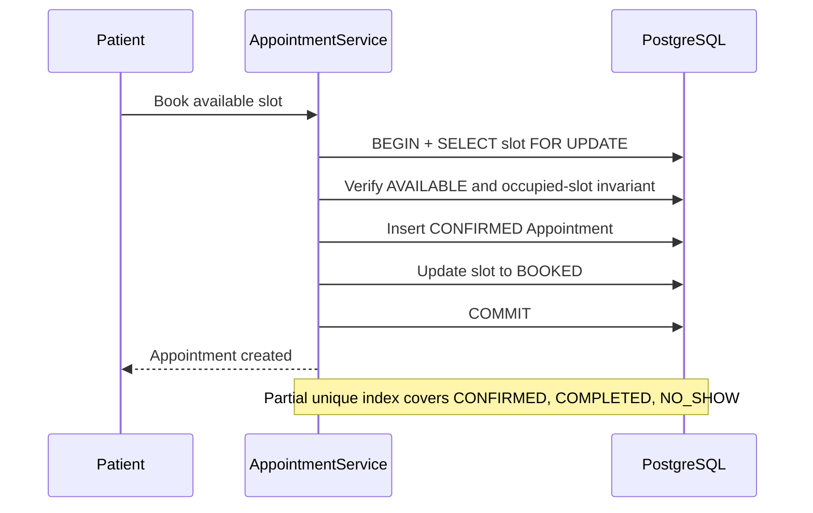

## 7. MedicalRecord Sequence

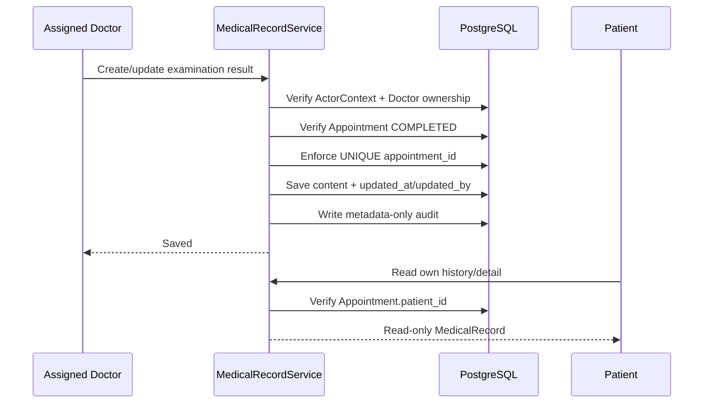

## 8. Document Ingestion Pipeline

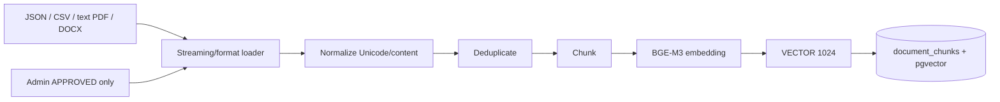

JSON is the primary large dataset format. CSV/PDF/DOCX remain supported for other sources. PDF requires extractable text; OCR is outside RAG V1.

## 9. RAG Pipeline

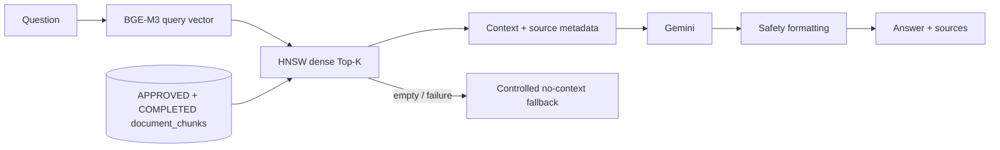

Runtime default is `hnsw_dense`; `exact_dense` is baseline/fallback. `hybrid_rrf` and `hybrid_rerank` are retained experiments, not default. MedicalRecord is not a corpus source.

## 10. Tool Calling Flow

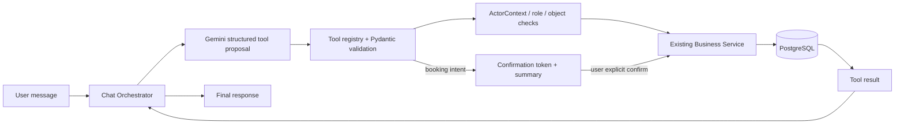

The LLM never receives authority to access ORM/SQL directly and cannot supply trusted identity/role.

## 11. Risk Alert Flow

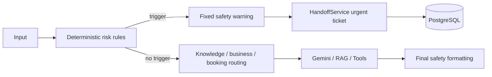

Risk Alert runs before Gemini so the LLM cannot hide the safety signal. It is escalation support, not diagnosis or prescription.

## 12. Handoff WebSocket Flow

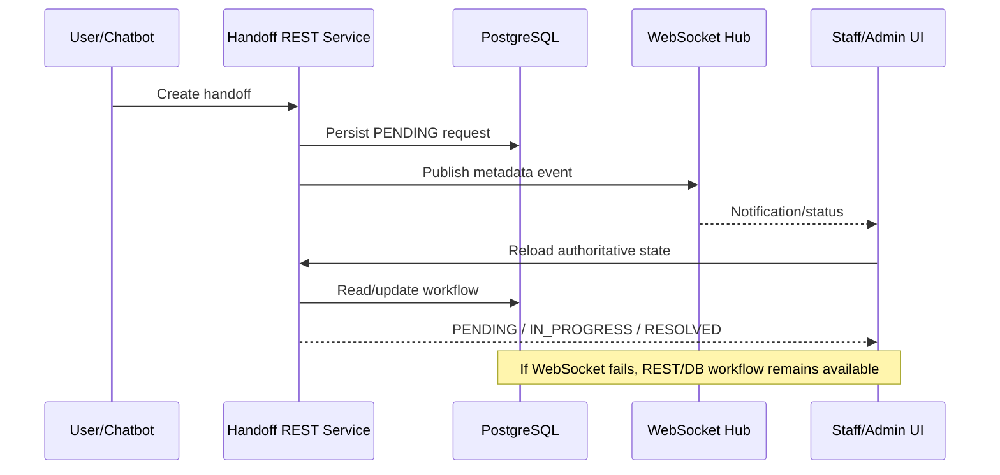

There is no live Patient-Staff chat in MVP.

## 13. Voice Pipeline

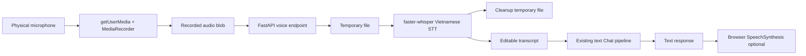

Voice is an input/output layer, not a second chatbot. Text remains the fallback. Vietnamese recognition quality varies by hardware/environment and is a recorded known limitation.
